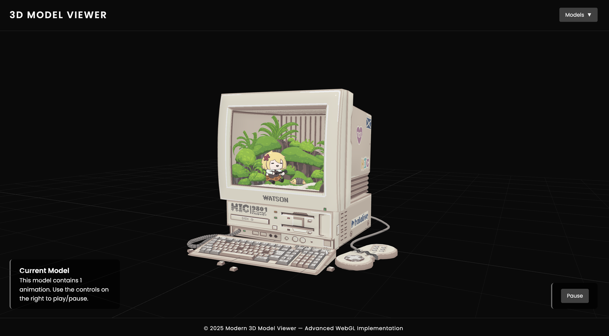

<div align="center">

# 3D Model Viewer

[](https://threejs.org/)
[](https://get.webgl.org/)
[](https://whoisridze.github.io/web-3dmodel-viewer/)

*Browser-based 3D model viewer with drag-and-drop support*

</div>

<div align="center">
  
</div>

## What is this?

A browser-based 3D model viewer. Load `.glb` models from the built-in library or drag-and-drop your own files — no install, no backend, just open the page.

Built with Three.js and vanilla JavaScript. No bundler, no framework, no dependencies to install.

## Features

- **Drag & drop** any `.glb` file onto the page to view it instantly
- **8 sample models** in the sidebar to browse
- **Orbit controls** — rotate, zoom, pan with mouse or touch
- **Animation playback** — play/pause and switch between embedded clips
- **Responsive** sidebar with mobile support
- **Accessible** — keyboard navigation, ARIA attributes, focus indicators

## Usage

Open the [live demo](https://whoisridze.github.io/web-3dmodel-viewer/) or serve locally:

```bash
# Using VS Code Live Server extension (recommended):
# Right-click index.html → Open with Live Server

# Or via terminal:
npx http-server . -p 8080
# Or: python3 -m http.server 8080
```

To view your own models, either:
- Drag a `.glb` file anywhere onto the page
- Click **Models > Load Your Model** in the sidebar

## Project structure

```
index.html              Entry point with import maps
js/
  main.js               Wires modules together, render loop
  scene.js              Three.js scene, camera, lights, controls
  model-loader.js       GLTF loading, disposal, camera fitting
  animation.js          AnimationMixer lifecycle
  ui.js                 Sidebar, info panels, loading states
  file-input.js         Drag-and-drop and file picker
  config.js             Named constants
styles/
  main.css              Theming via CSS variables, layout
assets/
  *.glb                 Sample 3D models
```

## Adding sample models

1. Drop a `.glb` file into `assets/`
2. Add a button to the sidebar in `index.html`:

```html
<button class="model-btn" data-model="your-model.glb">Your Model</button>
```

## Theming

Edit the CSS variables in `styles/main.css`:

```css
:root {
  --bg-color: #0a0a0a;
  --text-color: #f5f5f5;
  --accent-color: #404040;
  --highlight: #707070;
}
```
